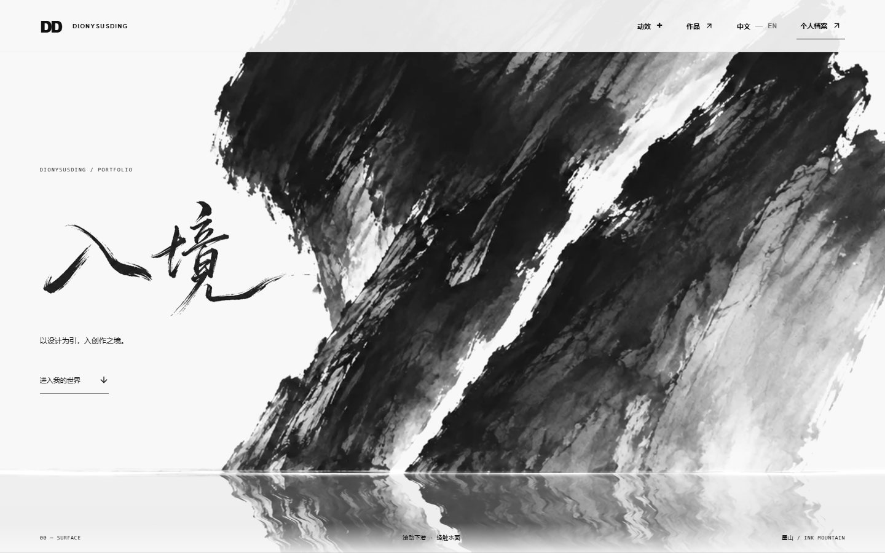
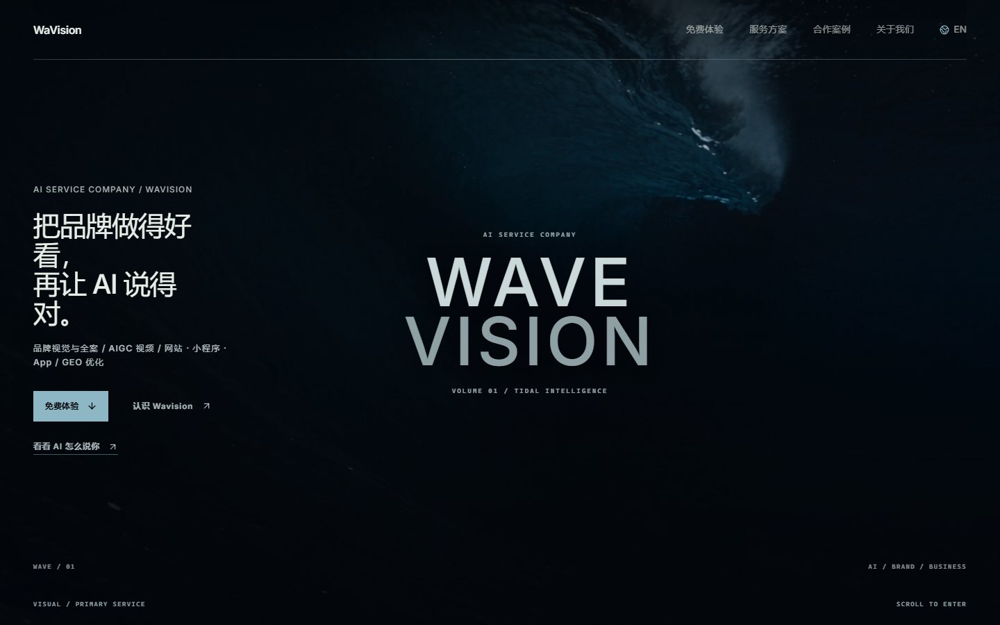
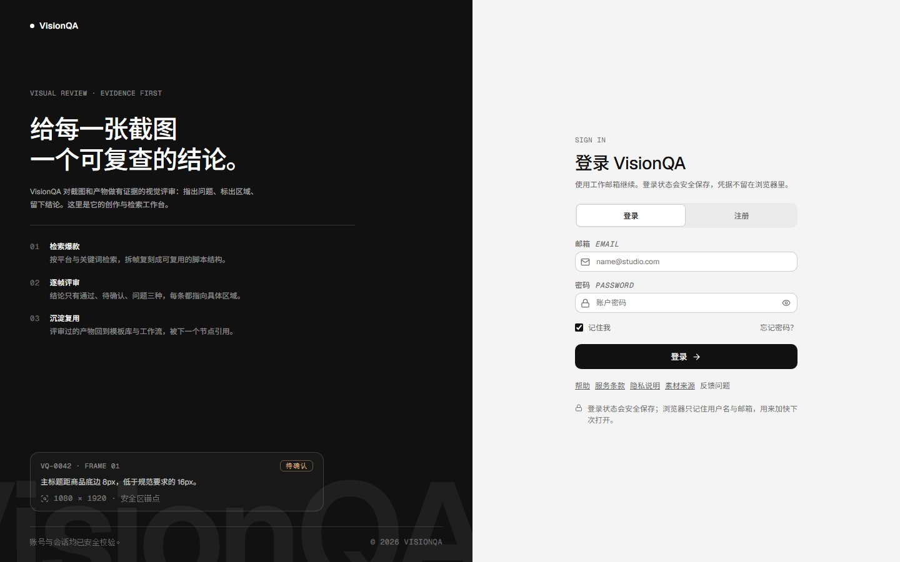

### 丁陈辉 · dingchenhui0618-arch

AI 视觉 · 品牌 GEO

<table>
  <tr>
    <td width="50%"></td>
    <td width="50%"></td>
  </tr>
  <tr>
    <td align="center"><a href="https://dionysusding.cn">dionysusding.cn</a> · 个人主页</td>
    <td align="center"><a href="https://wavisionai.cn">wavisionai.cn</a> · WaVisionAI 品牌官网</td>
  </tr>
</table>

## 最近在做

### [VisionQA](https://github.com/dingchenhui0618-arch/VisionQA) · 视觉评审工作台

线上入口：<https://visionqa.wavisionai.cn>（临时域名，需登录）

给每一张截图一个可复查的结论：接收截图/产物、DOM 摘要、对话目标和 revision，产出问题清单、证据锚点和有界修正方向。

  

- **检索爆款**：按平台与关键词检索，拆帧复刻成可复用的脚本结构
- **逐帧评审**：结论只分通过 / 待确认 / 问题三种，每条都落到具体区域
- **沉淀复用**：评审过的产物回到模板库与工作流，被下一个节点引用
- 插件形态可嵌进 Chrome / MCP / 桌面宿主；默认离线 Mock，真实多模态 Provider 只在本地显式配置后启用，证据不足时标 `NEEDS_CONTEXT` / `MANUAL_REVIEW`，不伪造像素结论

### [dsh-in-hand](https://github.com/dingchenhui0618-arch/dsh-in-hand) · 掌上 DSH 

不用装 App 的 DeepSeek Harness 手机端（PWA）：同一 Wi-Fi 走局域网直连，人在外面走中继，页面右上角随时切。

  
  
  

- **待批准一次点掉**：手机在线时直接给「批准一次 / 拒绝」，超时或手机切走就自动退回桌面
- **接着聊**：还是桌面上那批会话，手机上回一句就继续，逐字看着它跑
- **拍一张直接发**：发送前压到长边 1600、保留拍摄方向，原图不出手机
- **等待和交付物都在这一页**：进度、生成的图和 PDF 直接打开

### [dsh-tab-complete](https://github.com/dingchenhui0618-arch/dsh-tab-complete) · Tab 补全

在 DeepSeek Harness 输入框里预测你接下来要打的**整句**：灰色幽灵文本贴在光标后面，按 Tab 一键填入。

  

- **Tab** 整句收下；**Alt+→** 只收第一句；**Esc** 丢掉这条
- 只把「你和助手说过的话」喂给模型，技能目录这类框架注入会被挡掉
- 收下的句子只记在本机，越用越像你

### [dsh-poker-night](https://github.com/dingchenhui0618-arch/dsh-poker-night) · 德州扑克

无限注德州扑克，1 名玩家 + 7 位 LLM 智能体同桌（Altman、达里奥、马斯克、梁文峰、黄仁勋、雷军、张一鸣），固定八人桌，Web GUI 里多一个「德州扑克」Tab 和一个可拖动小窗。

  

- 智能体只能看见自己的底牌，桌边闲话不泄露推理或手牌
- 局域网联机：一台当主机，另一台加入后随机顶替一名人机角色，并告诉你顶替了谁
- 默认关闭，不占端口不发广播；基于 MIT 的 [BubblePtr/dsh-holdem](https://github.com/BubblePtr/dsh-holdem) 继续开发

### [dsh-doudizhu](https://github.com/dingchenhui0618-arch/dsh-doudizhu)

三人局域网斗地主，DSH 浮窗插件：一台做房主，两人凭码加入。

更多见 [仓库列表](https://github.com/dingchenhui0618-arch?tab=repositories)
